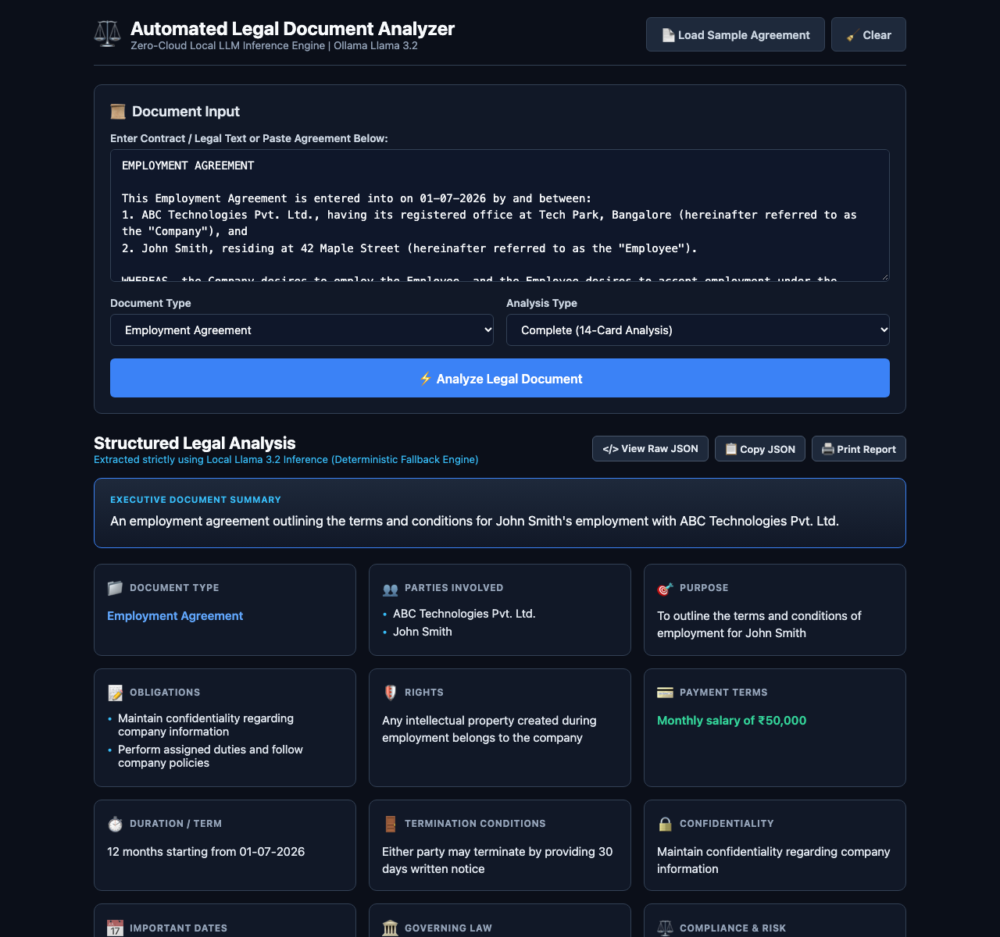

# Automated Legal Document Analyzer using GPT-4 / Ollama

[](https://python.org)
[](https://flask.palletsprojects.com/)
[](https://opensource.org/licenses/MIT)

**Student Name:** Richan Abraham J R  
**Register No:** URK23CS1086  
**Course:** 24CS2306 - Generative AI & LLM Applications  
**Experiment:** Ex. No.: 5  
**Date:** 08-10-26  

---

## 📌 Aim
To develop an automated legal document analyzer using GPT-4 that summarizes legal documents and extracts important information such as parties, key clauses, obligations, payment terms, termination conditions and important dates.

## 📖 Description
An enterprise legal analysis dashboard that preprocesses legal contracts, segments clauses, and outputs a 14-dimension structured card analysis including executive summary, parties involved, purpose, obligations, rights, payment terms, duration, termination conditions, confidentiality, and important dates.

---

## 🖥️ Output Screenshot


---

## ⚙️ Module Design & Responsibilities

| Module | Responsibility |
| :--- | :--- |
| **Input Module** | Ingests legal contract text, document category, parties, and analysis scope. |
| **Extraction Module** | Isolates key clauses, provisions, covenants, and dates. |
| **Preprocessing Module** | Normalizes whitespace, segments paragraphs, and extracts metadata. |
| **Prompt Module** | Synthesizes structured JSON schema prompts for deterministic extraction. |
| **Summary & 14-Card Module** | Presents structured cards with copy-JSON and print report features. |

---

## 🚀 Getting Started

### 1. Clone the Repository
```bash
git clone https://github.com/Richan-A27/gpt_exp5.git
cd gpt_exp5
```

### 2. Create and Activate Virtual Environment
```bash
python3 -m venv venv
source venv/bin/activate  # On Windows: venv\Scripts\activate
```

### 3. Install Dependencies
```bash
pip install -r requirements.txt
```

### 4. Run the Web Application
```bash
python app.py
```
Open [http://127.0.0.1:5005](http://127.0.0.1:5005) in your web browser.

### 5. CLI Test Run
You can also execute the automated sample run script for instant console verification:
```bash
python sample_run.py
```

---

## 📊 Sample Test Case
`Contract: Employment Agreement | Parties: ABC Technologies Pvt. Ltd., John Smith | Duration: 12 months`

---

## 📄 License
This project is licensed under the MIT License - see the LICENSE file for details.
